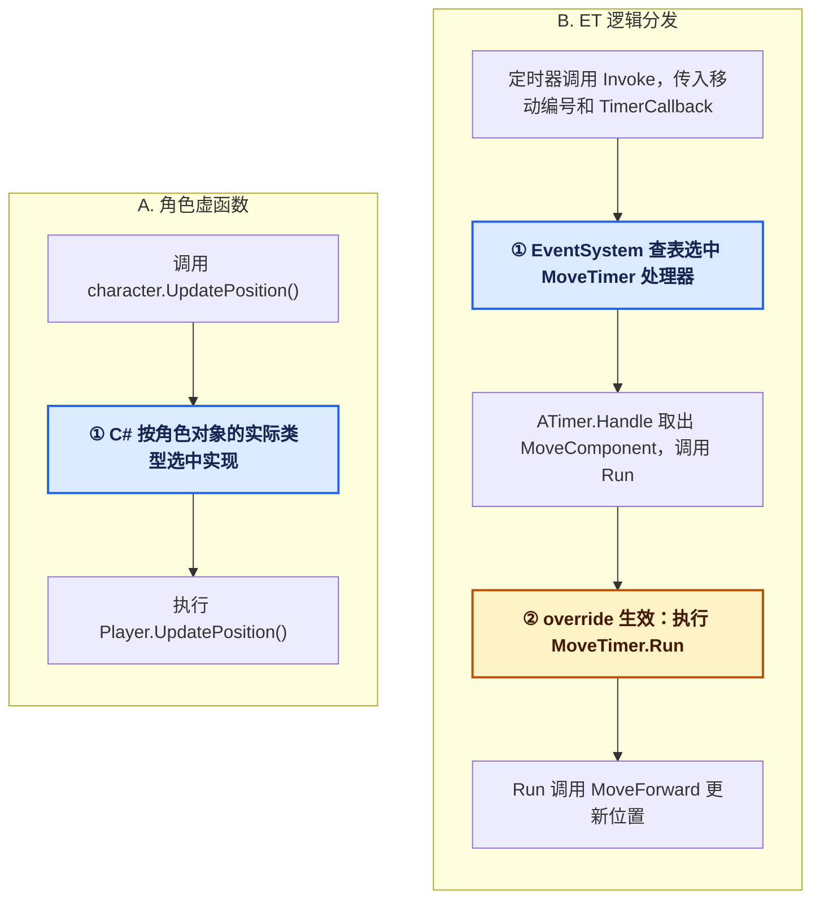

# 虚函数与逻辑分发：从 ET 的角色移动说起

这篇教程适合刚接触 C# 和 ET 的游戏开发者。读完后，你应该能回答两个问题：**一行调用最终执行哪段代码？是谁做的选择？**

## 1. 虚函数：看对象实际是什么类型

假设你在游戏里让不同单位发出叫声：

```csharp
class Creature
{
    public virtual void Speak()
    {
        System.Console.WriteLine("普通叫声");
    }
}

class Wolf : Creature
{
    public override void Speak()
    {
        System.Console.WriteLine("嗷呜");
    }
}
```

`virtual` 表示父类提供了默认实现，并允许子类重写。子类用 `override` 提供自己的实现。

```csharp
Creature a = new Creature();
Creature b = new Wolf();

a.Speak(); // 普通叫声
b.Speak(); // 嗷呜
```

两个变量都声明为 `Creature`，调用写法也一样。第二次却执行了 `Wolf.Speak()`，因为 `b` 指向的实际对象是 `Wolf`。**C# 运行时根据对象的实际类型选择实现**，这就是虚方法调用。抽象方法也支持这种调用，只是父类没有提供默认实现。

## 2. 逻辑分发：看任务带来了什么信息

想象一个通用定时器。它可以负责提醒角色更新位置、更新朝向，也可以提醒 Buff 结算。到时间时，它需要知道**该执行哪种逻辑**。

一种简单写法是根据任务编号写 `switch`。ET 的这个例子采用注册表：移动模块先登记“移动编号由移动处理器负责”；触发时，分发器查表找到处理器并调用。这个“根据输入选择处理逻辑”的过程就是**逻辑分发**。

| 方式 | 选择实现时看什么？ |
| --- | --- |
| C# 虚方法调用 | 被调用对象的实际类型，例如 `Wolf` |
| ET 定时器逻辑分发 | 回调参数类型与任务编号，例如 `TimerCallback` 和 `MoveTimer` |

## 3. 跟着 ET 源码走一遍：角色移动

假设一个角色要从横坐标 0 走到 10。移动逻辑会根据已经过去的时间多次更新位置。定时器负责提醒“该算一次了”，移动系统负责算“现在走到哪儿了”。

### 第一步：创建定时器，告诉它做什么、处理谁

[MoveComponentSystem.StartMove](../Packages/cn.etetet.move/Scripts/Hotfix/Share/MoveComponentSystem.cs#L184)：

```csharp
self.MoveTimer = self.Root().TimerComponent.NewFrameTimer(
    TimerInvokeType.MoveTimer, self);
```

- `TimerInvokeType.MoveTimer` 是**任务编号**，意思是“更新移动”。
- `self` 是**当前角色的移动组件**，它保存了移动速度、起点、目标点等数据。
- 左边的 `self.MoveTimer` 保存的是**本次创建的定时器 ID**，停止移动时用它移除定时器。它和右边的任务编号用途不同。

### 第二步：定时器触发，把任务交给分发器

[TimerComponentSystem.Run](../Packages/cn.etetet.core/Scripts/Core/Share/Timer/TimerComponentSystem.cs#L132)：

```csharp
EventSystem.Instance.Invoke(
    timerActionType, new TimerCallback() { Args = entity });
```

对这次移动任务而言，`timerActionType` 就是前面传入的移动编号，`entity` 就是前面传入的移动组件。定时器不需要知道它的速度或目标位置，只把编号和数据交出去。

### 第三步：分发器找到移动处理器，处理器更新位置

[MoveTimer 处理器](../Packages/cn.etetet.move/Scripts/Hotfix/Share/MoveComponentSystem.cs#L10) 的关键代码如下，省略了异常处理：

```csharp
[Invoke(TimerInvokeType.MoveTimer)]
public class MoveTimer : ATimer<MoveComponent>
{
    protected override void Run(MoveComponent self)
    {
        self.MoveForward(true);
    }
}
```

`[Invoke(...)]` 是登记信息。框架初始化时读取它，在 [EventSystem](../Packages/cn.etetet.core/Scripts/Core/Share/World/EventSystem/EventSystem.cs#L152) 中建立查找关系。触发时，分发器用 **`TimerCallback` 类型和移动编号**找到 `MoveTimer`，再把回调参数交给它。最终，`MoveForward` 根据经过的时间计算并更新角色的位置和朝向。

```text
开始移动 → 创建定时器（移动编号 + 当前移动组件）
         → 定时器触发 → 分发器查表找到 MoveTimer
         → MoveTimer.Run → MoveForward 更新位置
```

## 4. 对照示例：同样是更新角色位置

假设角色正在沿路径移动。每次收到更新提醒，都要根据经过的时间计算它现在的位置。下面两种写法的区别，在于**谁来选中负责更新位置的代码**。为便于比较，两段代码都省略了具体的位置计算。

**写法 A：通过虚函数选择实现（示意代码）**

```csharp
abstract class Character
{
    public abstract void UpdatePosition();
}

class Player : Character
{
    public override void UpdatePosition()
    {
        // 根据玩家的移动数据，计算并更新位置。
    }
}

// 更新入口持有的是角色对象。
Character character = new Player();
character.UpdatePosition();
```

调用方只知道手里是一个 `Character`。运行时发现这个对象实际是 `Player`，就执行 `Player.UpdatePosition()`。如果实际对象是另一个重写了该方法的角色子类，同一行调用就会执行那个子类的实现。

**写法 B：通过 ET 的逻辑分发选择处理器（项目代码摘录）**

```csharp
// 移动系统：登记一个定时任务，传入任务编号和当前移动组件。
self.Root().TimerComponent.NewFrameTimer(TimerInvokeType.MoveTimer, self);

// 通用定时器：触发时转交编号和实体。
// 在这次任务中，timerActionType 是移动编号，entity 是上面的移动组件。
EventSystem.Instance.Invoke(timerActionType, new TimerCallback { Args = entity });

// 移动模块：框架读取 Invoke 标记，把这个处理器登记到移动编号下。
[Invoke(TimerInvokeType.MoveTimer)]
public class MoveTimer : ATimer<MoveComponent>
{
    protected override void Run(MoveComponent self)
    {
        self.MoveForward(true); // 调用移动系统的静态扩展方法，更新位置。
    }
}
```

这三段分别位于移动系统、通用定时器和移动处理器中。定时器触发时，`EventSystem` 用 **`TimerCallback` 类型和移动编号**查表，找到 `MoveTimer`；处理器拿到这次传入的 `MoveComponent`，调用 `MoveForward`。

| 比较 | 虚函数写法 | ET 逻辑分发写法 |
| --- | --- | --- |
| 谁选择业务实现？ | C# 运行时根据角色对象的实际类型选择 | `EventSystem` 根据参数类型和任务编号查表 |
| 本次选中哪段代码？ | `Player.UpdatePosition()` | `MoveTimer.Run()`，进而调用 `MoveForward` |
| 换成另一名角色会怎样？ | 同为 `Player` 就执行同一实现；换成重写了该方法的子类才会改变实现 | 保持移动编号，只换成另一名角色的移动组件，仍执行同一个移动处理器 |

下面的流程图把两条调用路径放在一起。加粗的节点标出了选择实现的位置。



左边的 ① 直接根据**角色对象的实际类型**选择业务方法。右边的 ① 先按**回调类型和任务编号**选中处理器实例；到了 ②，才根据**处理器实例的实际类型**执行它重写的 `Run`。这时要更新哪个角色，仍由传入的 `MoveComponent` 决定。

可以把区别记成两句话：虚函数写法问的是**“这个对象是什么类型？”**；ET 的分发入口问的是**“这是什么任务，数据交给谁处理？”**

## 5. 为什么 Handler 里还有 override？

因为这个例子有**两次不同的选择**：

1. **选哪个处理器？** `EventSystem` 根据参数类型和编号查注册表。这一步是逻辑分发。
2. **怎么调用选中的处理器？** [ATimer.Handle](../Packages/cn.etetet.core/Scripts/Core/Share/Timer/ATimer.cs#L5) 把回调参数转为对应组件，再调用由子类重写的 `Run`。这里仍然用了虚方法机制。

所以，“用逻辑分发替代虚函数”在这个例子里说的是**业务行为的组织方式**。移动组件保存数据，移动系统提供逻辑，定时器按编号选择处理器。你可以给玩家和怪物都挂上移动组件，复用这套逻辑，而无需为玩家和怪物分别设计一套移动虚方法。

这样做的直接收益是：新增一个定时业务时，通常可以在自己的模块登记处理器，无需让通用定时器了解新业务。数据与逻辑分开，也便于把逻辑放在热更新层维护。注册表查找本身有成本，所以不必为了分发而分发：**已知要调用哪个 System 方法时直接调用；需要在运行时按编号或类型选择处理器时，再使用分发。**

## 6. 自测

- 同样是 `TimerCallback`，如果定时器传入转向编号，并且已经注册了转向处理器，会发生什么？  
  **答：** 分发器找到转向处理器，执行转向逻辑。
- 同样是移动编号，如果传入另一个角色的 `MoveComponent`，会发生什么？  
  **答：** 仍然找到同一个移动处理器，但更新的是另一个角色。编号决定**做什么**，组件决定**处理谁**。
